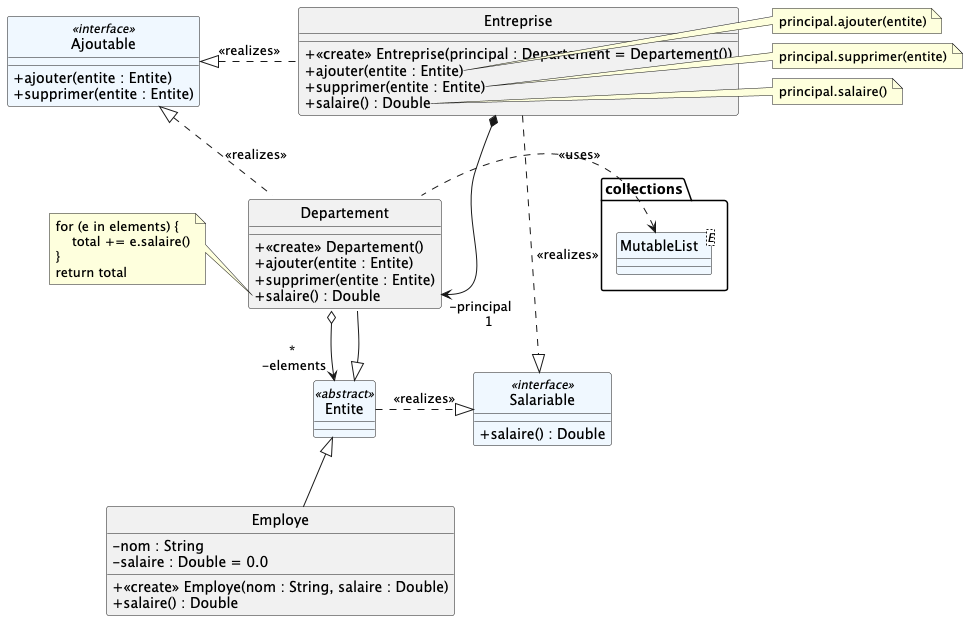
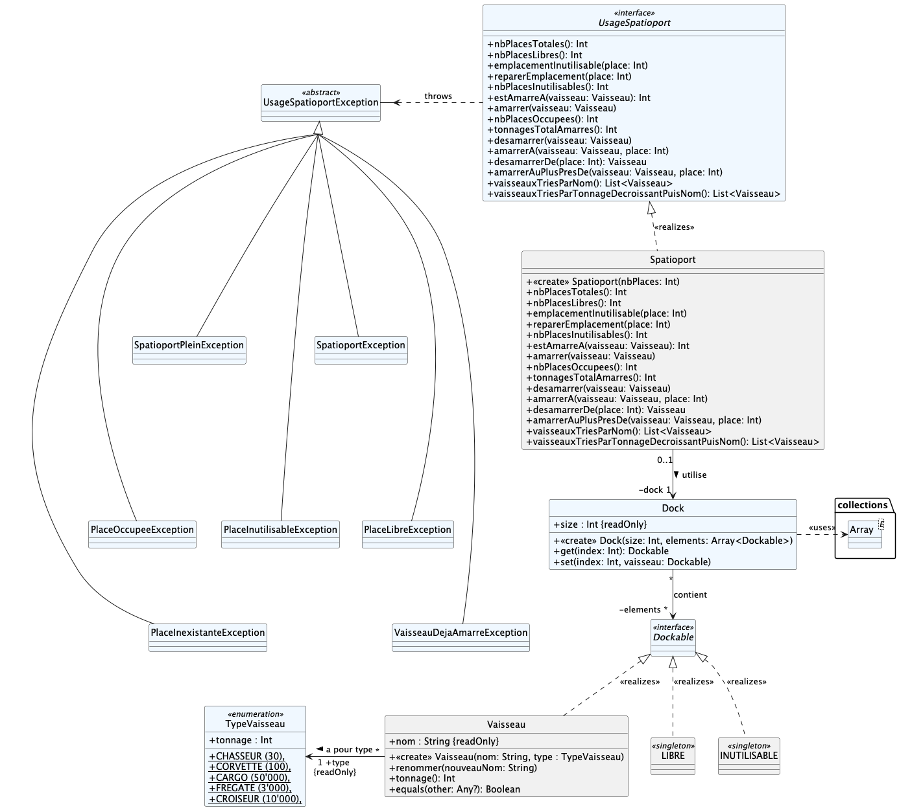
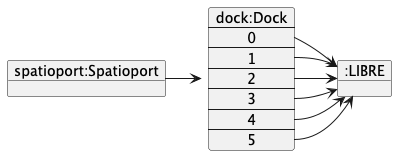
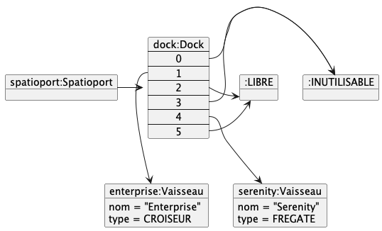

# qdev.dp.tp6

> Si vous êtes sur votre ordinateur personnel, 2 solutions pour que le projet s'ouvre correctement
>
> 1) utiliser **EduPVN** et _uniquement_ désactiver la configuration du proxy pour gradle en commentant les lignes
>    correspondantes dans le fichier `gradle.properties`
>
> 2) ne pas utiliser **EduVPN** et désactiver la configuration du proxy mais aussi
>   toutes les références à `nexus.dep-info.iut-nantes.univ-nantes.prive`dans `build.gradle.kts` et
>    `settings.gradle.kts`

## Exercice n°1 : Composite + Delegate

Il va s'agir d'implémenter l'exercice n°1 du TD n°6.

La spécification UML est la suivante :



Les classes en BLEU sont fournies et ne doivent pas être modifiées.

Complétez les classes afin d'implémenter correctement
les design patterns _Composite_ et _Delegate_

- `Employe` et `Departement` forment un _Composite_
- `Departement` _délègue_ à `MutableList` l'implémentation de l'interface `Ajoutable`
- `Entreprise` _délègue_ à `Departement` l'implémentation des interfaces `Salariable` et `Ajoutable` : utilisez
  l'opérateur Kotlin `by`

Des cas de tests vous permettent de valider votre implémentation (`.ktest`-> `.kt`).

#### Pour aller plus loin...

Ajoutez une méthode `listeEmployes() : List<Employe>` aux classes `Departement` et` Entreprise`
qui retourne la liste (à plat) de tous les employés de l'entreprise/département/sous-département.

Ajoutez des cas de tests validant cette nouvelle méthode.

## Exercice n°2 : Singleton

Implémentez correctement la spécification UML suivante :



Les classes en BLEU sont fournies et ne doivent pas être modifiées.

Les classes `LIBRE` et `INUTILISABLE` doivent être des Singletons Kotlin.

Toutes les méthodes à implémenter dans `Spatioport` sont documentées dans
l'interface `UsageSpatioport`.

> L'opérateur Kotlin `as` pourrait peut-être vous être utile ; il premet de `convertir' un objet vers sa classe réelle.
> Par exemple :
> ```kotlin
> val nimporteQuoi : Any = Personne("Jean", "Dupont")
> ...
> (nimporteQuoi as Personne).renommer("Jacques")
> ```

Le comportement attendu pour un spatioport est est le suivant :

```kotlin
val spatioport = Spatioport(6)
```

donne



```kotlin
spatioport.amarrerA(Vaisseau("Serenity", FREGATE), 4)
spatioport.emplacementInutilisable(3)
spatipoport.emplacementInutilisable(0)
spatioport.amarrer(Vaisseau("Enterprise", CROISEUR))
```

donne



Des cas de tests vous permettent de valider votre implémentation (`.ktest`-> `.kt`).