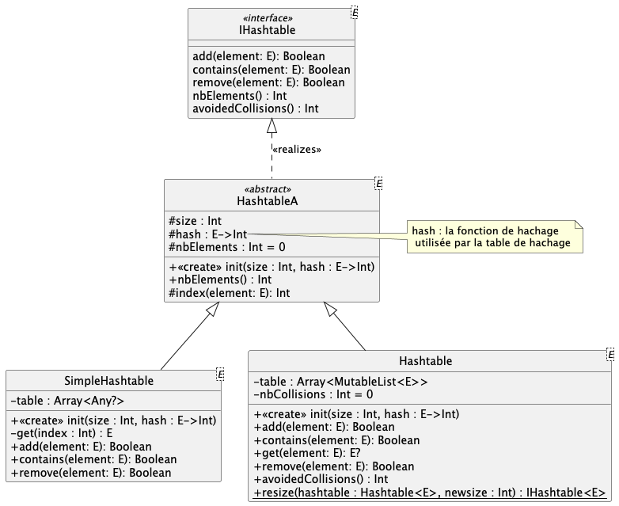

# qdev.dp.tp8 > Tables de hachage

> Si vous êtes sur votre ordinateur personnel, 2 solutions pour que le projet s'ouvre correctement
>
> 1) utiliser **EduPVN** et _uniquement_ désactiver la configuration du proxy pour gradle en commentant les lignes
     > correspondantes dans le fichier `gradle.properties`
>
> 2) ne pas utiliser **EduVPN** et désactiver la configuration du proxy mais aussi
     > toutes les références à `nexus.dep-info.iut-nantes.univ-nantes.prive`dans `build.gradle.kts` et
     > `settings.gradle.kts`

## Travail à faire

L'interface `IHashtable<E>` donne les fonctionnalités attendues par
une table de hachage.

La classe abstraite `HashtableA<E>` définit pour toutes les tables de hachage
un constructeur permettant d'initialiser une table de hachage à partir de 
- sa taille ; 
- une fonction de hachage `hash : E ->  Int`.

> **NB :** la fonction protégée `index(element : Int)` applique la fonction de hachage à un élément, modulo la taille de la table.
Il vous faudra l'utiliser dans les classes `SimpleHashtable` et `Hashtable` pour déterminer les indices des éléments 
à ajouter/rechercher/supprimer.

### Implémenter `SimpleHashtable`

La classe `SimpleHashtable<E>` est une table
de hachage **sans gestion des collisions**, c-à-d que l'arrivée d'une collision 
provoquera la levée d'une exception `CollisionException`.

La structure de données interne proposée peut vous sembler complexe :

    table : Array<Any?>

Il s'agit d'un tableau de _tout et n'importe quoi_, donc d'éléments
de type `E`. On est obligé de faire ainsi car on ne peut pas directement déclarer un tableau de `E`.

Ce tableau doit initialisé à `null`

    table = arrayOfNulls<Any?>(size)

La méthode `get(index) : E` réalise déjà la conversion d'un élément de type `Any` vers un élément de type `E` quand l'élément n'est pas `null`, ce qui devrait simplifier l'écriture du reste de votre code.
On peut procéder ainsi car on est sûr que l'on n'ajoutera que des éléments de type `E` dans la table.

Des cas de tests vous permettent de valider vos développements.

### Implémenter `Hashtable`

La classe `Hashtable<E>` est une table
de hachage gérant les collisions par chaînage externe.
L'arrivée d'une collision ne lève donc plus d'exception.

La structure de données interne proposée ici correspond bien à l'attendu, c-à-d un tableau de listes :

    table : Array< MutableList<E> >

L'initialisation permet de remplir la table avec autant de
listes vides que nécessaire.

Des cas de tests vous permettent de valider vos développements.

## Implémenter le TD papier

Dans `TestTD.kt`, testez les 3 tables de hachage manipulées en TD : 

Pour chacune, réalisez le scénario suivant :
- instanciez une table de hachage
- ajoutez-y tous les mots de la liste
- vérifiez que chacun des mots de la liste est bien dans la table

## Comparer l'efficacité d'une liste et d'une table de hachage

Dans le fichier `PerformancesListsVsHashtables.kt`, écrivez un programme qui :

- Lit les mots un par un dans le fichier `dico-en_100.txt` (contient ~100 mots) et les ajoute dans
la table de hachage ET dans la liste
- Recherche la présence/l'absence du mot `"XXXXXX"` dans la table et dans la liste
- Mesure le temps nécessaire pour chaque recherche
- Affiche les temps mesurés

Que constatez-vous ?

Refaites l'expérience avec le fichier `dico-en.txt` qui contient ~13'000 mots.

Faites varier la taille de la table de hachage, puis comparez les temps de recherche.

Vous pouvez aussi modifier la fonction de hachage pour voir si cela a un impact sur les performances.

## Rendre `Iterable` les deux tables de hachage

Ajouter l'interface `Iterable<E>` à l'interface `IHashtable` et implémenter un itérateur
pour chacune des tables de hachage, **sans reconstruire une liste de tous les éléments, avant d'en prendre un itérateur,
ca ce serait triché.**

Des cas de tests vous permettent de valider vos développements dans
`TestHashtableIterators.kt` (`.ktest` -> `.kt`).

## Générer la documentation 

Pour générer automatiquement de la documentation, il faut utiliser l'outil `dokka` de kotlin 
voir la [documentation de Dokka](https://kotlinlang.org/docs/dokka-introduction.html).

1. Ajoutez dans la partie `plugins` du fichier `build.gradle.kts` : `id("org.jetbrains.dokka") version "1.9.20"`
2. Rechargez le fichier `build.gradle.kts` en appuyant sur le "petit éléphant" en haut à droite de l'éditeur de texte
3. Affichez l'onglet `Gradle` (tout à droite dans l'IDE) ; parmi la liste des tâches gradle, lancez la tâche 
  ` documentation > dokkaHtml` (le premier lancement est long, car dokka télécharge ce dont il a besoin)
4. Consultez la documentation qui a été générée dans `build/dokka/html/`
5. Complétez/modifiez les commentaires de documentation dans les fichiers sources des classes fournies
6. Re-générez la documentation et vérifiez que vos ajouts/modifications sont bien pris en compte.

## Tables de hachage et Ensemble

La classe `Hashset<E>` donne une implémentation d'un ensemble : voir la 
[documentation de Hashset<E>](https://kotlinlang.org/api/latest/jvm/stdlib/kotlin.collections/-hash-set/).

Par définition un ensemble est une `collection sans doublon`. `Hashset<E>` utilise une structure interne de
type _table de hachage_ pour stocker les éléments et surtout, pour détecter efficacement les doublons et
donc ne pas les ajouter à l'ensemble. 

Comme fonction de hachage, elle utilise la méthode `hashCode()` de la classe `E`. 
Cette méthode est définie dans `Any` et peut-être redéfinie par n'importe quelle classe 
pour implémenter le hachage souhaité.

Plus pragmatiquement, `Hashset<E>` implémente l'interface `MutableSet<E>`.

Nous allons implémenter notre version d'un ensemble dans la classe `MySet<E>` ; cette classe
* implémentera l'interface `ISet<E>` (voir la [documentation de MutableSet<E>](https://kotlinlang.org/api/latest/jvm/stdlib/kotlin.collections/-mutable-set/) pour la documentation des méthodes)
* utilisera notre table de hachage pour stocker les éléments de l'ensemble et détecter les doublons lors de l'ajout.

Des cas de tests vous permettent de valider vos développements dans `TestMySet`.

Dans le fichier `PerformanceSets.kt`, écrivez un programme qui :

- Lit les mots un par un dans le fichier `dico-en_100.txt` (contient ~100 mots) et les ajoute dans
  les deux ensembles
- Recherche la présence/l'absence du mot `"XXXXXX"` dans les deux ensembles
- Mesure le temps nécessaire pour chaque recherche
- Affiche les temps mesurés

