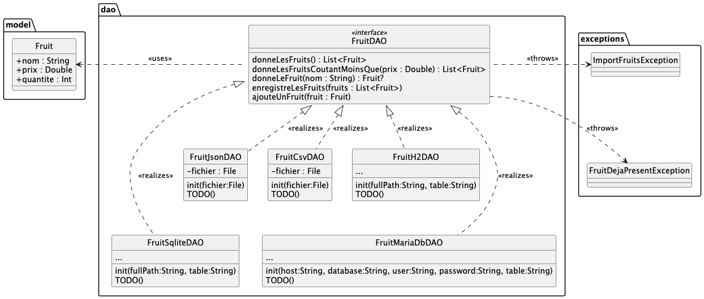
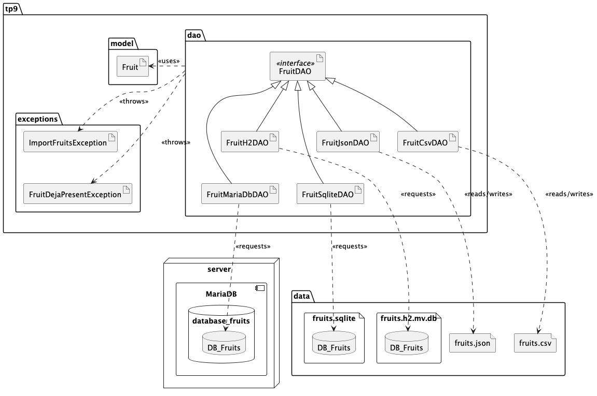

# qdev.dp.tp9 > DAO

> Si vous êtes sur votre ordinateur personnel, 2 solutions pour que le projet s'ouvre correctement
>
> 1) utiliser **EduPVN** et _uniquement_ désactiver la configuration du proxy pour gradle en commentant les lignes
     > correspondantes dans le fichier `gradle.properties`
>
> 2) ne pas utiliser **EduVPN** et désactiver la configuration du proxy mais aussi
     > toutes les références à `nexus.dep-info.iut-nantes.univ-nantes.prive`dans `build.gradle.kts` et
     > `settings.gradle.kts`

La data class `Fruit` (fournie) représente un fruit à vendre.

Nous voudrons manipuler des données de type `Fruit` provenant
de plusieurs sources différentes :

- un _fichier JSON_, un _fichier `.csv`_,
- une (ou des) _base(s) de données_

Ces manipulations devront être transparentes pour l'utilisateur.

### Fichier JSON

Le fichier `data/fruits.json` contient des fruits au format JSON

Implémentez pour commencer le classe `FruitJsonDAO` réalisant `FruitDAO`
en utilisant la sérialisation/de-sérialisation Kotlin comme vu dans un TD précédent ;

Notez la présence dans `build.gradle.kts` de :

      plugins {
          ...
          kotlin("plugin.serialization") version "1.9.21"
      }

      dependencies {
          ... 
          implementation("org.jetbrains.kotlinx:kotlinx-serialization-json:1.6.3")
          ...
      }

Si nécessaire, rechargez `build.gradle.kts` en cliquant sur le "petit éléphant" ;-)

**Ne pas stocker de liste de fruits dans le DAO : le DA0 n'est qu'un "intermédiaire"**

Regardez le fichier `TestFruitJson` qui doit vous permettre de tester
votre implémentation de `FruitJsonDAO`

_NB : dans le `@BeforeEach`, on commence
par "recopier" à chaque fois le fichier `fruits.json` dans un dossier `test/`
avant de charger le DAO ; cela permet d'exécuter chaque cas de tests dans un
environnement initial maîtrisé et toujours ré-initialisé._

### Fichier CSV

Le fichier `data/fruits.csv` contient des fruits au format CSV.

Implémentez maintenant la classe `FruitCsvDAO` réalisant là encore `FruitDAO`.

Vous pouvez :

1. utiliser une librairie dédiée comme
   [Apache Commons CSV](https://commons.apache.org/proper/commons-csv/)
   ou
   [Kotlin CSV](https://github.com/jsoizo/kotlin-csv)
2. ou bien tout faire à la main.

`TestFruitsCsv`  vous permettra de tester votre implémentation.

`TestFruitsCsvJson` compare les deux implémentations du DAO `FruitDAO`.

## Databases

_Il va s'agir d'interagir maintenant avec une base de données : SQLite, H2, MariaDB, Oracle...
Quel que soit le moteur de bases de données utilisé, on considèrera toujours une
simple table `DB_Fruits` définie ainsi en SQL_

       TABLE DB_Fruits (
           Nom VARCHAR(200) PRIMARY KEY NOT NULL,
           Prix REAL NOT NULL,
           Quantite INT NOT NULL
       )

Pour faire interagir du code Kotlin avec une BDD, on va
utiliser [JDBC](https://fr.wikipedia.org/wiki/Java_Database_Connectivity)
et un driver spécifique à chaque BDD.

### Database H2

[H2](https://fr.wikipedia.org/wiki/H2_(base_de_donn%C3%A9es)) est un moteur de BDD basé écrit en Java qui ne nécessite
aucune
installation particulière. Les tables sont soit créées en mémoire vive, soit sur le disque.

Pour installer le driver JDBC pour H2, il faut ajouter à `build.gradle.kts` :

    dependencies {
      implementation("com.h2database:h2:2.1.214")
    }

Le code exemple `ExempleH2.kt` vous "résume" comment interagir avec une BDD H2 définie dans le fichier
`persons.h2.mv.db`. Vous pouvez exécuter `ExempleH2.kt`.

Le fichier `fruits.h2.mv.db` correspond à une BDD H2 définissant une table `DB_Fruits`.

Implémentez maintenant la classe `FruitH2DAO` qui réalise `FruitDAO` ;
On réalisera les requêtes dans la table dont le nom sera passé en paramètre du constructeur `FruitH2DAO`.

**Vous ferez bien entendu TOUS les traitements sur les données, au niveau des requêtes SQL.**

`TestFruitsH2` vous permettra de tester votre implémentation.

_NB : dans le `@BeforeEach`, on commence
par "copier" dans la BDD la table `DB_Fruits` avant de charger le DAO avec une table `DB_Fruits_XXXXX` ;
cela permet d'exécuter chaque cas de tests dans un environnement initial maîtrisé._

`TestFruitsH2json` compare les deux implémentations du DAO `FruitDAO`.

### Database SQLite

[SQLite](https://fr.wikipedia.org/wiki/SQLite) est un autre moteur de BDD basé fichier.
Il nécessite que SQLite soit installé sur le poste sur lequel on veut l'utiliser,
ce qui est le cas sur vos postes IUT.

Pour utiliser SQLite, il faut ajouter le bon driver JDBC :

    dependencies {
      implementation("org.xerial:sqlite-jdbc:3.39.3.0")
    }

Une BDD définissant une table `DB_Fruits` vous est fournie dans `data/fruits.sqlite`.

Implémentez maintenant la classe `FruitSqliteDAO` qui réalise `FruitDAO`.

Vous devriez constater que cette implémentation ne change pas grand-chose
à celle de `FruitH2DAO`.
Généraliser votre code pour éviter toute duplication du code ?

`TestFruitSqlite` vous permet de tester votre implémentation.

### Database MariaDB

**NB : ce dernier exercice sera uniquement réalisable sur les postes de l'IUT.**

[MariaDB](https://fr.wikipedia.org/wiki/MariaDB) est un moteur de BDD relationnelle nécessitant
l'installation/configuration d'un serveur de BDD.

Téléchargez le fichier
`db-server.tar` [ici](https://drive.google.com/file/d/1uRCaQakZ9W_4-9ip0qhqg1pB5-nS01d3/view?usp=sharing)

Ce fichier contient une `machine virtuelle` ; cette machine virtuelle
utilise _systemd-nspawn_ installé sur les postes de l'IUT pour déployer facilement des machines virtuelles (voir
la [documentation complète](https://www.iut-nantes.univ-nantes.fr/etu/wiki/index.php/Machines_virtuelles.html)
concernant les machines virtuelles.)

Pour lancer la machine virtuelle fournie, exécutez dans un terminal les commandes suivantes :

    exit                        // pour revenir sur la Silverblue
    vm-import db-server /path/to/db-server.tar
    vm-run db-server            // pour lancer la VM : vous devriez maintenant être connecté sur la  machine virtuelle
    ip a                        // pour obtenir l'adresse IP de la machine virtuelle

Vous devriez obtenir une adresse IP de la forme `172.21.180.177`.

La machine virtuelle `db-server` éxecute un serveur MySQL/MariaDB proposant une base de données `database_fruits`,
contenant une unique table `DB_Fruits`. Pour vous connecter les informations suivantes
sont à utiliser : `user` comme utilisateur et `password` comme mot de passe (on est au top de la sécurité
informatique ;-)).

Implémentez la classe `FruitMariaDbDAO` ; il vous faut le bon driver JDBC :

    dependencies {
        implementation ("org.mariadb.jdbc:mariadb-java-client:3.1.0")
        implementation("org.slf4j:slf4j-simple:1.7.30")
    }

`TestFruitMariaDb` vous permet de tester votre implémentation.
Vérifiez que l'IP de la machine virtuelle correspond bien à la variable `host` dans le fichier `TestFruitMariaDb.kt`.

