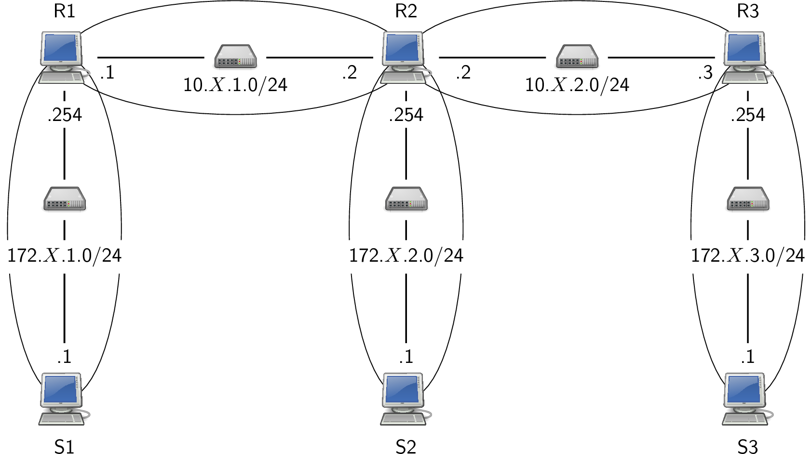
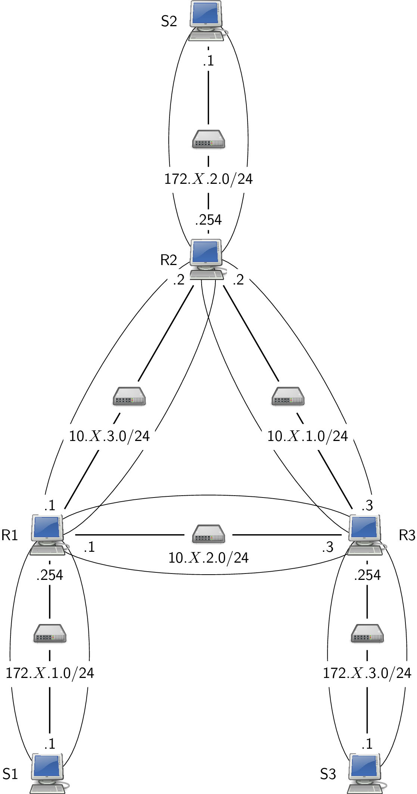

# Td Architecture des réseaux : Routage

Le `X` des adresses IP qui suivent est à remplacer par le numéro de prise ou le numéro de la machine dans la salle.

## Préambule

Nous allons travailler sur des machines virtuelles pour les TPs réseaux de cette année. Afin de se familiariser avec cette nouveauté, nous allons reprendre une activité de l'année passée.

Vous disposez de la possibilité d'ajouter des machines virtuelles depuis la Silverblue via la commande `vm-add`.

* consulter le manuel de `vm-add`
* ajouter trois machines virtuelles **debian** nommées respectivement `S1`, `S2` et `R1`.
* consulter le manuel de `vm-ls`
* lister les machines virtuelles disponibles
* consulter le manuel de `vm-run`
* démarrer `S1` et `S2`

## 1 Rappels

### 1.1 Adresse IP

Chaque interface réseau (i. e. carte réseau) d'un hôte du réseau 
possède (au moins) une adresse IP unique dans le réseau. Une 
interface ethernet peut être désignée par un nom ”traditionnel” comme ethX où X est le numéro de l'interface ou un nom ”prédictible” comme enp0s25. 
Une adresse IP est un nombre de 32 bits souvent noté en décimal pointé ; 
quatre entiers (compris entre 0 et 255) séparés par des points. 
Exemple : 192.168.2.200. L'adresse IP est structurée en deux 
parties : 

1. partie réseau : permet de désigner le réseau (netID)

2. partie hôte : permet de désigner l'hôte dans le réseau 
  (hostID)

Un masque de sous-réseau permet de séparer partie réseau et 
partie hôte. Ce masque ; une succession de 1 suivi d'une 
succession de 0 donne l'étendue de la partie réseau.

* mettre la partie host à 0 nous donne l'adresse du réseau. Ceci 
  se fait par un et bit à bit entre adresse IP et masque. Exemple 
  pour 192.168.2.200 avec un masque de 255.255.224.0 : 
    
```
192.168.2.200     11000000.10101000.00000010.11001000

     ET                           ET

255.255.224.0     11111111.11111111.11100000.00000000

     =                             =

192.168.0.0       11000000.10101000.00000000.00000000
```

* mettre tous les bits de la partie réseau à 0 nous donne la 
  partie hôte. 

* mettre tous les bits de la partie hôte à 1 nous donne l'adresse 
  de diffusion dans le réseau.

### 1.2 Routage

Un hôte voulant faire une transmission constitue un paquet IP qui 
contient l'adresse du destinataire et l'adresse de l'expéditeur. 
Au niveau de la couche réseau, le routage utilise une table de 
routage qui contient une ou plusieurs lignes contenant chacune 
essentiellement trois informations : 

1. une adresse de réseau

2. un masque de réseau

3. comment atteindre le réseau : soit directement par une 
  interface connectée sur ce réseau (on parle de routage direct 
  ou de remise directe), soit en passant par un routeur (on parle 
  de routage indirect) qui est identifié par son IP et 
  l'interface à utilisée pour l'atteindre.

Un routeur peut être un équipement spécialisé ou simplement un 
hôte ordinaire relié à plusieurs réseaux.

Le décision de routage se fait par la recherche d'une 
correspondance dans la table de routage en appliquant pour chaque 
ligne, le masque de réseau à l'adresse de destination. Quatre cas 
peuvent alors se présenter : 

1. le réseau de la destination est directement connecté. Il y une 
  remise directe en utilisant le réseau local sous-jacent.

2. le réseau de la destination est accessible via un routeur. Le 
  paquet est transmis au routeur sans changer les adresses IP de 
  l'émetteur et du destinataire.

3. le réseau de la destination est absent de la table de routage, 
  mais il existe une route par défaut. Le paquet est transmis au 
  routeur désigné.

4. le réseau de la destination est absent de la table de routage, 
  et il n'existe pas de route par défaut. Envoi d'un message ICMP 
  à l'émetteur : `Network is unreachable`

Chaque routeur recevant un paquet IP applique le même algorithme.

### 1.3 Type de routage

Les deux types connus de routage sont : 

1. le routage statique

2. le routage dynamique ou auto-adaptatif

Par routage statique, on entend que les tables de routage sont 
renseignées manuellement, par opposition au routage dynamique où 
celles-ci sont construite par application d'un algorithme 
distribué au niveau des routeurs.

### 1.4 Commandes

Les commandes réseaux sont présentes sous deux formes :

* les commandes vénérables : `ifconfig`, `arp` et `route` que nous n'allons pas utiliser

* la nouvelle commande `ip` (du paquet iproute2) : `ip link`, `ip addr`, `ip neigh` 
  et `ip route`


#### interface

consultation : `ip link`, activation d'une interface `eth1` : `ip link set eth1 up`

#### adressage

consultation : `ip addr`, configuration d'une interface `eth0` : `ip addr add 192.168.1.1/24 dev eth0`

#### voisinage

consultation  : `ip neigh`

#### routage

consultation : `ip route`, configuration : ajout avec `add`, suppression avec `del` ; route par défaut : `default`. Exemple :

```
ip route add 172.20.11.0/24 via 192.168.1.253
```

## 2 Configuration réseau

Observez la configuration réseau initiale de `S1`. 

* Combien d'interfaces réseaux sont-elles disponibles ? 
* Quelle(s) est(sont) vos ip ? 
* Qu'avez-vous comme route(s) ? 
* Quels type de liens sont disponibles ? 
* Quelles sont vos adresses MAC ? 
* Quel est l'état du cache arp ?
* ajouter les ip `192.168.X.101/24` sur `s1` et `192.168.X.102/24` sur `s2` en utilisant dans les deux cas l'interface `eth3`
* lancer un `ping` (qui génère un trafic ICMP `echo request/echo reply
  permettant de tester la connectivité) entre `S1`et `S2`
* reconsulter l'ensemble des informations.

## 3 Routage statique

Il est rappelé que bien souvent, les stations ordinaires 
(qui ne sont pas des routeurs) se contentent d'UNE IP sur UNE 
interface avec UNE route par défaut.

### 3.1 Situation 1


* configurer les interfaces des trois stations (normalement, vous 
  avez 4 interfaces à configurer). Il faut impérativement utiliser des interfaces homologues (i.e. de même nom) si vous voulez les faire communiquer.

* consulter les tables de routages des trois stations

* avec la commande `ping`, depuis `S1`, déterminer quelles sont les 
  communications possibles et impossibles vers les 4 interfaces. 
  Expliquer. 

* Dans `S1`, ajouter une route permettant d'atteindre le réseau 
  `172.X.2.0/24`.

* Attention le `forwarding` (la fonction de retransmission d'un 
paquet) peut ne pas être actif. Pour en consulter la valeur, deux possibilités existent :
  * `cat /proc/sys/net/ipv4/ip_forward`
  * `sysctl net.ipv4.ip_forward`

pour modifier cette valeur, deux possibilités existent :
 
* `echo 1 > /proc/sys/net/ipv4/ip_forward` (que fait cette commande ?)
* `sysctl net.ipv4.ip_forward=1`

`sysctl` peut permettre de pérenniser la modification. (Dé)commenter la ligne `net.ipv4.ip_forward=1` dans le fichier `/etc/sysctl.conf`. Puis recharger la 
configuration, `sysctl -p`.

* ajouter la route ”retour” sur `S2`

* tester

* Sur `S1` et `S2`, supprimer les routes ajoutées et mettre 
  seulement des routes par défaut.

* tester.

### 3.2 Situation 2




#### Mettre en place la situation :

* configurer les interfaces 

* configurer le routage

* tester

## 4 Routage dynamique




Configurer `S1`, `S2` et `S3` avec ip et route par défaut. Dans la suite, seuls les routeurs sont à modifier.

Nous allons utiliser la suite logicielle `frr` qui fournit les protocoles de routage dynamique les plus courants : OSPF, RIP et BGP. `frr` est un *fork* de `quagga`. Il est possible le de configurer comme on le ferait pour un routeur matériel (type CISCO) via telnet ou avec des fichiers de configuration. La consultation de l'état du routeur se fait, elle aussi, par telnet.

Commencer par par installer `frr` : 

```
apt update --allow-realeaseinfo-change
apt install frr
```

### 4.1 OSPF

* Pour configurer le routage ospf, trois fichiers sont à produire/modifier sur chacun des routeurs :

1. Le fichier `/etc/frr/daemons` permet de spécifier les démons de routage à activer. Pour notre cas : 

```
bgpd=no
ospfd=yes
ospf6d=no
ripd=no
ripngd=no
isisd=no
```

2. Le fichier [`/etc/frr/frr.conf`](frr.conf). Ce fichier est fourni avec `A` numéro du routeur en cours de configuration, `B` et `C` numéro des deux autres routeurs (à adapter !!). On y configure les adresses IP : `interface N` puis `ip address` et il est conseillé de spécifier la bande passante pour chaque interface en bits/seconde de manière à avoir un coût ”conforme” : `bandwidth 100000`

3. Le fichier [`/etc/frr/ospfd.conf`](ospfd.conf). Le routeur est un routeur ospf : `router ospf`, on déclare les réseaux sur lesquels chercher des routeurs voisins `network ... area 0`

* droits pour ces fichiers 

```
chown frr:frr /etc/frr/ospfd.conf && chmod 640 /etc/frr/ospfd.conf
chown frr:frr /etc/frr/frr.conf && chmod 640 /etc/frr/frr.conf
```

* pour les logs 

```
mkdir -p /var/log/frr && chown frr:frr /var/log/frr 
```

* lancer `frr`

```
systemctl restart frr
```

* vérifier le lancement des démons (`ps ...`)

* tester (ping)

* consulter les tables de routages (`telnet localhost zebra`, puis `show ip route`)

```
R1> show ip route 

Codes: K - kernel route, C - connected, S - static, R - RIP, O - OSPF, I - ISIS, B - BGP, > - selected route, * - FIB route

...

O 10.1.2.0/24 [110/1] is directly connected, interface, 00:02:30
...
```

Noter le [110/1] qui indique la priorité d'une route ospf par rapport aux autres sources des routes (0 connecté, 1 static , 20 BGP, 110 ospf et 120 RIP) et le 1 le coût du lien.

Faire la même chose depuis un terminal : 

* `ip route` 

* consulter les information du routeur ospf (`telnet localhost ospf`, puis `show ip ospf` avec éventuellement `neighbor` ou `route` en complément) 

* faire un ping entre `S1` et `S2`. couper le lien entre `R1` et `R2`. 

* constater l'évolution des tables de routage
