# R4.11 TD 1 : Outils Android -  *Composables* et *Layouts*

## Objectifs

* prise prise en main d'Android Studio et de ses outils de développement,
* découverte des différents éléments graphiques et leur disposition.

## Outils Android
 
### Android Studio

L'outil de développement pour créer des applications est `android studio`. Dans un premier temps, il va nous permettre de  découvrir les outils du sdk. 

* Créez une application android avec le `+`
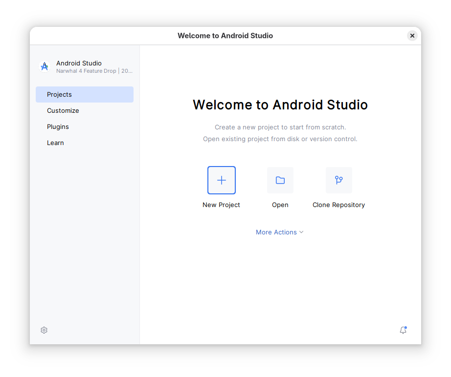

* Choisissez `Empty Activity`
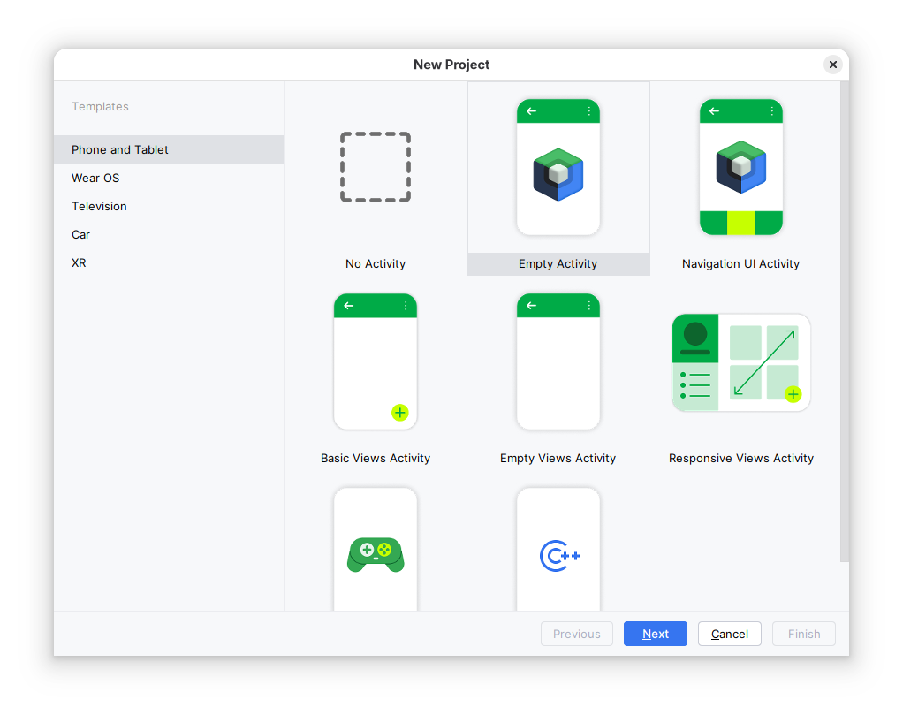

* Choisissez le `Minimum API level` : `API 23 : Android 6.0 (Marshmallow)` et le langage kotlin 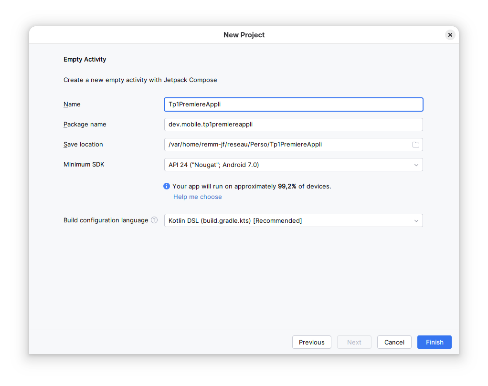

* Attention à laisser le proxy actif via https avec la valeur `srv-proxy-etu-2.iut-nantes.univ-nantes.prive` : 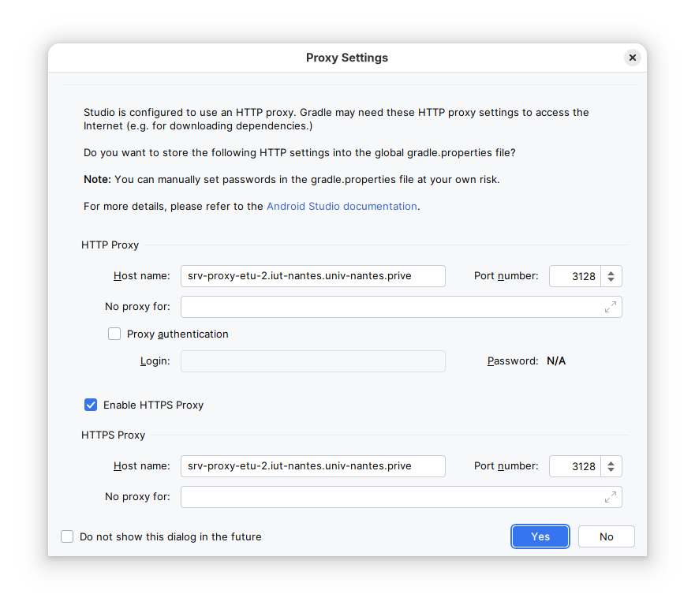
* si besoin, vous pouvez corriger : `File ⟶ Settings... ⟶ Appearance & Behavior ⟶ System Settings ⟶ HTTP Proxy` avant de relancer _Sync Project with Gradle Files_

### SDK manager
Le *SDK manager* est l'outil permettant de gérer les plateformes et outils android installés. 
Lancez le via l’icône  et regardez les éléments présents sur votre machine.

### Device Manager / Emulator
Le _Device Manager_ est l'outil qui permet de gérer les périphériques virtuels à votre disposition. Lancez le via l’icône 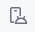. Un périphérique, une fois défini, peut être utilisé pour tester une application. Une fois démarré, il est accessible depuis _Emulator_ La documentation de l'émulateur est accessible à l'url suivante : [https://developer.android.com/studio/run/emulator.html](https://developer.android.com/studio/run/emulator.html)

En plus d'utiliser la barre d'outils, il est également possible d'envoyer des commandes à l'émulateur via telnet (sur `localhost`, port `5554`).

 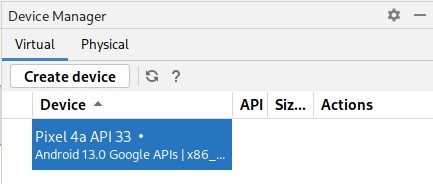
 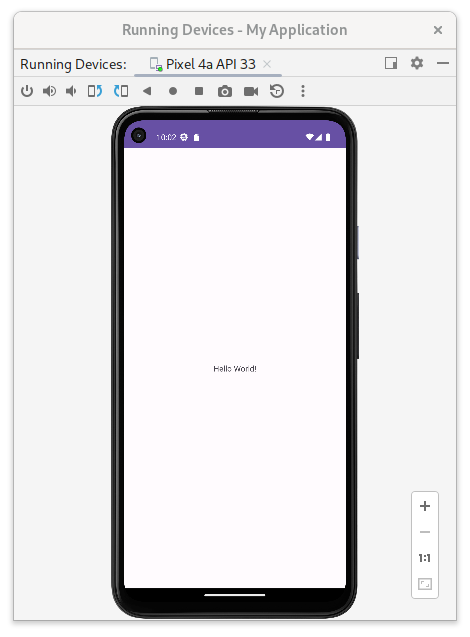 

* Définissez un nouveau périphérique :
    1. `Select Hardware` pixel 4a par exemple,
    2. `System Image` : *Recommanded* API 36 (au besoin, en faire l'installation) et vérifier que l'émulateur est installé
* Lancez cet émulateur depuis Android Studio.
* Testez le changement d'orientation.
* Mettez le périphérique en français.
* Utilisez chrome. Testez la désactivation du réseau (wifi/cellulaire).
* Téléchargez une image.
* Activez la localisation, définissez des coordonnées GPS (latitude 47.223 ; longitude -1.545 ou iut joffre par exemple) et affichez la carte correspondante à l'aide de maps. 
* Envoyez un sms à l'émulateur.
* Simulez un appel.
* Lancez votre première application sur votre émulateur.
* ...

## Device Explorer
* Retrouvez l'image précédemment téléchargée

## Logcat / Run
Il est possible de suivre l'exécution d'une application (message de log, sorties de votre application, crash d'application)
* Ajoutez un affichage (`println`) dans la méthode `onCreate` de votre application et retrouver le message dans le panneau _Logcat_
* Faites de même dans les méthodes  `onDestroy`, `onStart`, `onDestroy`, `onResume` et `onPause` de votre application pour visualiser le cycle de vie de votre application. En particulier, lorsque vous changez d'application, que vous changez de langue ou que vous basculez d'orientation.

## Première application

* Lancez votre première application sur votre émulateur.
* Lancez votre première application sur une tablette (physique).
* Quel composant est utilisé pour afficher le texte ?
* Modifiez ce texte d'abord en dur, puis dans le fichier XML adéquat des ressources. Faites le afficher en utilisant ([`stringRessource`](https://developer.android.com/develop/ui/compose/resources?hl=fr))
* Mettez une couleur de fond définie en dur
* Mettez une couleur de texte puisée dans le thème

## Mises en formes basiques	

Les différents composants et conteneurs utilisables sont documentés ici : 

* [`https://developer.android.com/reference/kotlin/androidx/compose/material3/package-summary`](https://developer.android.com/reference/kotlin/androidx/compose/material3/package-summary)
* [`https://developer.android.com/reference/kotlin/androidx/compose/foundation/layout/package-summary`](https://developer.android.com/reference/kotlin/androidx/compose/foundation/layout/package-summary)
* [`https://m3.material.io/components`](https://m3.material.io/components)

### Stylisation de texte 

Reproduire la disposition suivante : 

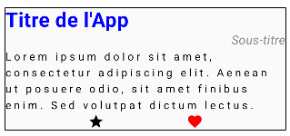

Indications : 

* créez une `Column` contenant :
    1. un titre : texte en gras, de grande taille (30 `sp`), et de couleur bleue
    2. un sous-titre : texte en italique, de taille moyenne, et de couleur grise, aligné à droite
    3. un corps : texte normal, avec un espacement entre les lettres plus large
    4. deux `Icon` (`Icons.Default.XXX`) dans une `Row`, la deuxième teintée en rouge

### Grille

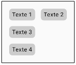

* Commencez par faire un composant utilisant un `Box` et un `Text` en gérant couleur de fond et espacement

* Disposez quatre de ces composant en gérant l'espacement

### Centrage

* Reprenez votre composition précédente et centrez la dans l'application. Pour ceci, deux solutions : 
    1. Utilisez une `Box` englobante avec un modifier `fillMaxSize` puis centrez grace à `contentAlignment`
    2. Utilisez une `Row` ou `Column` englobante, toujours avec un modifier `fillMaxSize` puis centrez dans les deux dimensions à l'aide des propriétés d'arrangement et d'alignement

## Exercices de synthèse

### Badge de CV simplifié

Reproduire la disposition suivante : 

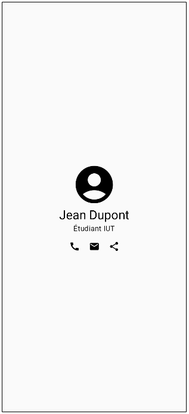 

Indications : 

### Formulaire de contact

Reproduire la disposition suivante : 

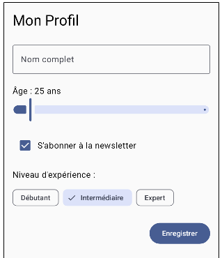 

Indications : 

* la colonne principale utilise un arrangement `spacedBy` pour espacer les composants
* les composants `OutlinedTextField`, `Slider`, `Checkbox`, `FilterChip` ont été utilisés
* pour tous les composants, les éventuels `onXXXChange` `onClick` sont mis à la valeur `{}`
* pour le `FilterChip`, la `leadingIcon` est `Icons.Default.Check`
* Définissez un `verticalScroll` (avec comme valeur, pour l'instant, un `ScrollState(0)`) pour la colonne principale. Testez en mode paysage.

