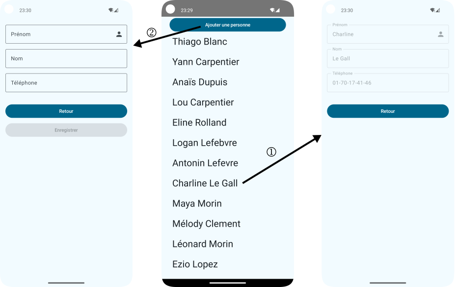

# R4.11 TD 3 : Listes & Communication entre Activités


## Objectifs

1. faire une `LazyList`
2. passer d'une activité à une autre :
	- avec ou sans transmission de données,
	- avec ou sans données en retour
	- explicitement ou implicitement

Nous allons réaliser l'application suivante :

   


## Liste de personne
La classe `Person` ainsi qu'une liste préremplie sont fournies. Une structure de base a été mise en place pour réaliser votre première liste différée. Complétez `PersonScreen`. En particulier, il vous faudra compléter le code à l'emplacement où figure le `TODO()` ET choisir la bonne structure de données pour votre liste de personnes.

## Gestion du clic sur un item
L'organisation de la gestion du clic sur un item de la liste a été conservé. 

- Commencez par produire une sortie (nom + prénom de la personne sur laquelle on clique) dans le logcat. 
- puis, dans un deuxième temps, modifiez la personne (qui est remplacée par la même avec son nom en majuscule) 

## Intent explicite
- lancez l'activité `DetailActivity` au clic sur le bouton. Ceci se fait en créant un `Intent` désignant  `DetailActivity ` comme activité cible puis à démarrer celle-ci. Le context se récupère par : `val context = LocalContext.current`


## Modification de la classe `Person`
L'implantation de l'interface `Parcelable` dans une classe permet de passer un objet de celle-ci, en plus des types de base (Int, String, ...), d'une activité à l'autre. Cette implantation d'interface peut se faire de deux manières : soit implanter vraiment l'interface, soit annoter la classe avec `@Parcelize` ce qui fera le travail.
Pour nous permettre d'utiliser `android.os.Parcelable` et `kotlinx.parcelize.Parcelize`, les modifications suivantes ont été apportées à la configuration `gradle` du projet :

- ajout dans le fichier `libs.versions.toml` de  `kotlin-parcelize = { id = "org.jetbrains.kotlin.plugin.parcelize"}`
- ajout dans le fichier `build.gradle.kts` (`:app`) de `alias(libs.plugins.kotlin.parcelize)`

Modifiez `Person.kt` pour qu'elle implante l'interface `Parcelable`

voir : [https://developer.android.com/kotlin/parcelize](https://developer.android.com/kotlin/parcelize) et [https://developer.android.com/reference/android/os/Parcelable.html](https://developer.android.com/reference/android/os/Parcelable.html)

## Intent explicite avec passage de données
Le clic sur un item permet maintenant de passer dans l'intent, la personne sur laquelle le clic s'est fait. Et, les champs nom, prénom et téléphone sont correctement remplis. 

## Intent explicite avec retour
   - le clic sur le bouton permet maintenant de saisir une nouvelle `Person` dans l'activité `DetailActivity`.
   - Les deux boutons annulent ou de valident la saisie. En cas de validation (`OK`), les informations saisies sont transmises à la première activité par un extra. En cas d'annulation, on retourne également à la première activité.
   - En cas d'enregistrement, la `Person` saisie doit être ajouté au modèle.
   - Pas en cas d'annulation.
   - le traitement du résultat a été préparé avec un contrat personnalisé

## Intent implicite avec retour

- Assurez-vous d'avoir un contact disponible dans le gestionnaire de contact de votre dispositif de test.
- le bouton `pick` dans l'activité `DetailActivity` démarre le gestionnaire de contact. Ceci se fait en utilisant un `Intent` implicite :
  	+ action : `Intent.ACTION_PICK`,
  	+ type : `ContactsContract.Contacts.CONTENT_TYPE` 
- le choix d'un contact vous ramène en arrière en positionnant un résultat et des données.
- remplir le champ de texte avec le nom du contact

## Pour aller plus loin
Nous allons maintenant coder une activité capable de visualiser des images.

- Créez une activité pouvant recevoir des `Intent` implicites. Pour ce faire, dotez le manifest de notre activité d'une section `intent-filter`. Cette section doit impérativement intégrer la catégorie `CATEGORY_DEFAULT` et bien sûr ce qui indique la capacité à visualiser (VIEW) des images.
 
```
<intent-filter>
  <action android:name="android.intent.action.VIEW" />
  <data android:mimeType="image/*" />
  <category android:name="android.intent.category.DEFAULT" />
</intent-filter>
<intent-filter>
      <category android:name="android.intent.category.DEFAULT"/>
      <action android:name="android.intent.action.VIEW"/>
      <data
          android:mimeType="image/*"
          android:scheme="content" />
</intent-filter>
```
- Créer une activité avec une `Image` ...
- Utiliser les données fournies
- Télécharger une image et par `Ouvrir avec` depuis l'application `Fichiers` de votre émulateur, votre activité devrait être proposée

source : 
[https://developer.android.com/guide/components/intents-filters.html](https://developer.android.com/guide/components/intents-filters.html)

