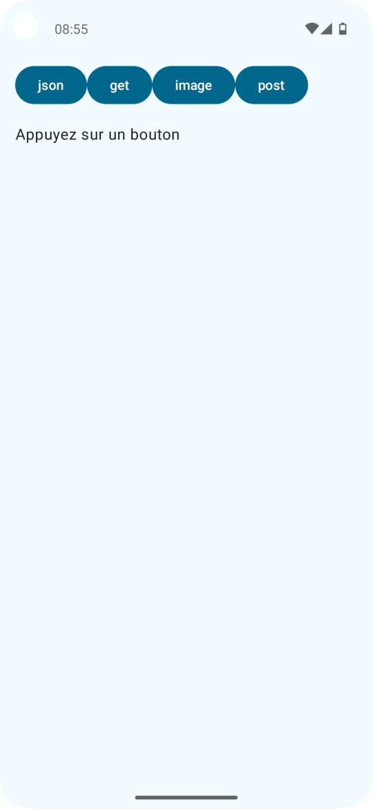

# R4.11 TD 4 : Réseaux et Services Web

Beaucoup d'éléments figurant dans ce sujet ont été emprunté à A. Lanoix, que je remercie.

## Objectifs

- consommer un service web REST
- afficher des images chargés par http


Le premier projet est `Td4Debut`. La vue est fournie.



## Configuration des permissions


- Dans le manifest (`AndroidManifest.xml`) du projet, accordez les permissions d'accès à internet et de consultation de l'état du réseau : 
```
<uses-permission android:name="android.permission.INTERNET" />
<uses-permission android:name="android.permission.ACCESS_NETWORK_STATE" />
```

## Client `ktor`
`ktor` est une bibliothèque kotlin qui permet l'envoi asynchrone de requêtes HTTP. Vous l'avez déjà utilisée en Qdev au semestre précédent.
 
- Consulter `libs.versions.toml`. Les ajouts suivants ont été faits :

```
[versions]
ktor = "3.0.0"
[libraries]
ktor-client-android = { group = "io.ktor", name = "ktor-client-android", version.ref = "ktor" }
ktor-client-logging = { group = "io.ktor", name = "ktor-client-logging", version.ref = "ktor" } 
```

- Consulter `build.gradle.kts (:app)`. Les ajouts suivants ont été faits :
```
implementation(libs.ktor.client.android)
implementation(libs.ktor.client.logging)
```
- Consultez la documentation : [https://ktor.io/docs/client-requests.html](https://ktor.io/docs/client-requests.html)
- Dans votre application, un client Ktor est instancié. Vous pourrez compléter sa configuration avec l'installation de plugin, en particulier `ContentNegotiation` et `HttpTimeout`. La documentation est accessible ici :  [https://ktor.io/docs/client-plugins.html#plugin-dependency](https://ktor.io/docs/client-plugins.html#plugin-dependency)
- Au clic sur le bouton `get` la méthode `fetchGet` du viewModel est appelée. On souhaite obtenir la page d'accueil de `https://www.perdu.com` sous forme de texte (une `String`). Pour ce faire :  
	1. Implantez la méthode `fetchGet` : mettez le `_uiState` à `ScreenState.Loading`, puis, depuis le scope  `viewModelScope` lancez une coroutine qui appelle la méthode correspondante du repository, puis modifie `_uiState` en conséquence (`ScreenState.SuccessText` ou `ScreenState.Error`) en fonction du succès ou de l'échec de l'appel. Testez
	2. Implantez maintenant la méthode `suspend fun get(): Resource<String>` du repository. Utilisez la méthode `get` du `HttpClient` puis `bodyAsText()` en renvoyant `Resource.Success()` ou `Resource.Error()` selon le succès ou non de l'appel. 
- De la même manière, au clic sur le bouton `post` envoyez des données à `https://httpbin.org/post` en utilisant la méthode `POST` et faites affichez le contenu de la page de retour. Vous aurez besoin de `submitForm ` de `HttpClient` avec l'utilisation de `formParameters` (par exemple : `formParameters = parameters { append("username", "lanoix") append("password", "lechef")}`

## Images : `Coil`

Coil est également une bibliothèque qui permet le chargement aisé d'images dans votre application.
- Consultez la documentation : [https://coil-kt.github.io/coil/](https://coil-kt.github.io/coil/)
- Dans `libs.versions.toml` ajoutez : 
```
[versions]
coil = "2.7.0"
[libraries]
coil-compose = { group = "io.coil-kt", name = "coil-compose", version.ref = "coil" }
```
- Dans `build.gradle.kts (:app)` ajoutez : 
```
implementation(libs.coil.compose)
```

-  au clic sur le bouton `img`, affichez une image distante (par exemple : `https://picsum.photos/200/300`). Ceci est fait en insérant une `AsyncImage` dont la documentation est accessible ici : [https://coil-kt.github.io/coil/compose/](https://coil-kt.github.io/coil/compose/)).


## Json
- `kotlinx-serialisation-json`est une bibliothèque Kotlin pour (dé)sérialiser des chaînes au format JSON de classes Kotlin.

- Activez le plugin `serialization`. Dans `libs.versions.toml`, ajoutez :
```
[versions]
serialization = "1.8.0"
[libraries]
ktor-serialization-kotlinx-json = { group = "io.ktor", name = "ktor-serialization-kotlinx-json", version.ref = "ktor" }
ktor-client-content-negotiation = { group = "io.ktor", name = "ktor-client-content-negotiation", version.ref = "ktor" }
kotlinx-serialization-json = { group = "org.jetbrains.kotlinx", name = "kotlinx-serialization-json", version.ref = "serialization" }
[plugins]
kotlin-serialization = { id = "org.jetbrains.kotlin.plugin.serialization", version.ref = "kotlin" }
```

- Dans `build.gradle.kts (:app)`, ajoutez :
```
plugins {
     alias(libs.plugins.kotlin.serialization) } 
 }
 implementation(libs.ktor.client.content.negotiation)
 implementation(libs.ktor.serialization.kotlinx.json)
```

- en n'oubliant pas de resynchroniser `Gradle`

- Vous pouvez maintenant annoter une classe avec `@Serializable`, ce qui permet de sérialiser ou desérialiser cette classe (ou une liste de cette classe).
- sous android studio, installez le plugin `JSON To Kotlin Class`
- définir la *data class* `Todo` correspondant à : 
```
{
	"userId": 1,
	"id": 4,
	"title": "eum et est occaecati",
	"todos": "ullam et saepe reiciendis ..."
}
```
- Associez au clic sur le bouton `json`, la désérialisation de la chaine de caractère précédente en un objet `Todo` (vous pouvez consulter la documentation : [https://github.com/Kotlin/kotlinx.serialization/blob/master/docs/basic-serialization.md#json-decoding](https://github.com/Kotlin/kotlinx.serialization/blob/master/docs/basic-serialization.md#json-decoding) ou le TP de M. Lanoix : [https://gitlab.univ-nantes.fr/iut.info2.qdev.dp/2024-2025/qdev.dp.tp7](https://gitlab.univ-nantes.fr/iut.info2.qdev.dp/2024-2025/qdev.dp.tp7)) et faites afficher `title`
- Utilisez maintenant `ktor` pour récupérer directement le `Todo` : `https://jsonplaceholder.typicode.com/todos/5` en ayant pris soin d'installer le plugin nécessaire : 
```
        install(ContentNegotiation) {
            json( Json {
                prettyPrint = true
                // autres configurations 
                // éventuelles du (dé)sérialiseur
            })
        }
```
Vous mettrez en oeuvre toujours la même manière de faire dans le viewModel, mais par contre, dans le repository, au lieu de `bodyAsText`, vous employerez la méthode `body`.